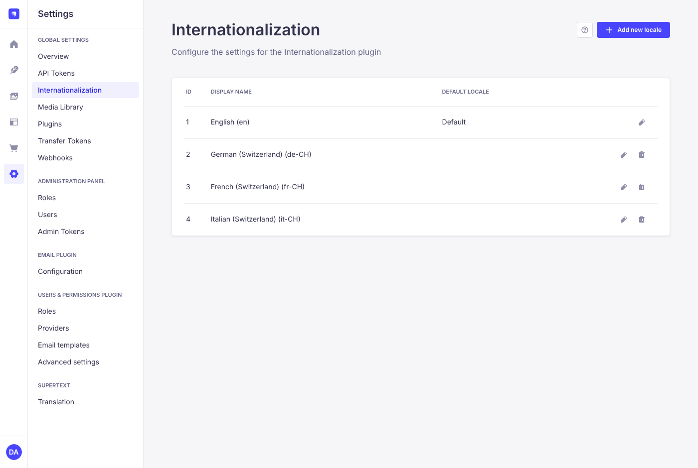

# Installation guide — Supertext Translation for Strapi

For administrators setting up the plugin in a Strapi project.

## Requirements

| | |
| --- | --- |
| Strapi | 5.x (tested with 5.57) |
| Node.js | 20 or newer (22 or 24 recommended; tested with 20, 22 and 24) |
| Database | Any database Strapi supports (tested with SQLite; the demo runs on PostgreSQL) |
| Strapi i18n | Enabled for every content type you want to translate (*Content-Type Builder → Advanced settings → Internationalization*), with the target languages added under *Settings → Internationalization* |
| Supertext | An account with an API key — see [Get a Supertext account and API key](#get-a-supertext-account-and-api-key) |
| Network | The Strapi server must reach `https://api.supertext.com` over HTTPS |

The languages Supertext translates into are Strapi's own locales:



Each Strapi locale needs a Supertext language. Supertext accepts exactly these target codes (from its `features` list, October 2026):

| Language | Supertext codes |
| --- | --- |
| German, English, French, Italian, Portuguese | `de-DE`, `de-CH`, `de-AT`, `en-US`, `en-GB`, `fr-FR`, `fr-CH`, `it-IT`, `it-CH`, `pt-PT`, `pt-BR` |
| Chinese, Serbian | `zh-Hans`, `zh-Hant`, `sr-Latn`, `sr-Cyrl` |
| Swiss German | `gsw-u-sd-chzh` (Zurich), `gsw-u-sd-chbe` (Bern) |
| All others, without region | `bg`, `cs`, `da`, `el`, `es`, `fi`, `hr`, `hu`, `ja`, `ko`, `nb`, `nl`, `pl`, `rm`, `ru`, `sk`, `sl`, `sq`, `sv`, `tr` |

- A Strapi locale that **is** one of these codes (apart from upper/lower case and `_`/`-`) is used as it is: `de-CH`, `fr_ch`, `es`. The source language is sent without region (`en-US` → `en`).
- **Every other locale needs a `code`** in the plugin's `locales` setting (the language mapping, see [All settings](#all-settings)), e.g. `de: { code: 'de-CH' }`, `en: { code: 'en-US' }`, `zh-CN: { code: 'zh-Hans' }`. The plugin never guesses a region: an unmapped locale gets the message *has no Supertext language yet* and nothing is sent for it. Strapi's default locale `en` is one of them; as a source it works without a mapping (sources are bare). One `code` serves both directions: with `en: { code: 'en-US' }`, English is translated into `en-US` and from `en`.
- Formal/informal (`politeness`) isn't offered for English, Swiss German, Romansh, Albanian and Serbian; leave those on `default`, otherwise translating into them fails with *no formal or informal tone*.

The settings page shows the code each locale is sent as, and *Not mapped* for locales that still need a `code`.

### Get a Supertext account and API key

1. **Account:** no Supertext account yet? [Log in or create a Supertext account](https://www.supertext.com/person/en/account/signin) with your email address.
2. **API key:** generate the AI API key at [supertext.com → Integrations → API](https://www.supertext.com/en/integrations/api). This page requires the **Admin** role in your Supertext account; if you don't have it, ask an admin of your Supertext account to generate the key.

The plugin's settings page (*Settings → Supertext → Translation*) shows the same two links.

## 1. Install the package

The plugin isn't on npm yet. Build it from GitHub and install the tarball:

```bash
git clone https://github.com/Supertext/Strapi-Supertext-Translation.git
cd Strapi-Supertext-Translation
npm ci && npm run build && npm pack
# → strapi-plugin-supertext-translation-<version>.tgz

cd /path/to/your-strapi-project
npm install /path/to/strapi-plugin-supertext-translation-<version>.tgz
```

Once it's published to npm this becomes `npm install strapi-plugin-supertext-translation`.

## 2. Enable and configure it

In `config/plugins.js` (or `.ts`):

```js
module.exports = ({ env }) => ({
  supertext: {
    enabled: true,
    config: {
      apiKey: env('SUPERTEXT_API_KEY'),
      // Per Strapi locale: the Supertext code (needed if the locale isn't one) and politeness
      locales: {
        'de-CH': { politeness: 'more' },   // a Supertext code already; formal: Sie
        'fr-CH': { politeness: 'more' },   // formal: vous
        'pt': { code: 'pt-BR' },           // Strapi's "pt" → Brazilian Portuguese
        'zh': { code: 'zh-Hans' },         // Strapi's "zh" → Simplified Chinese
      },
      // versionReports: false,            // see "Version information and the API key check"
    },
  },
});
```

Set the key as an environment variable on the server, for example in `.env`:

```bash
SUPERTEXT_API_KEY=your-key
```

Never commit the key to the repository.

## 3. Rebuild and restart

```bash
npm run build
npm run start      # or: npm run develop
```

A new **Supertext translation** panel now appears in the right-hand column of every localized entry in the Content Manager, and **Settings → Supertext → Translation** shows the configuration and the installed plugin version (for example *Plugin version: 0.1.0*, linked to that release's notes on GitHub). Mention the version when you contact support.


## 4. Check it works

1. Open *Settings → Supertext → Translation* and click **Test connection**. You should see *API key checked: the connection to Supertext works.* Check that no locale says *Not mapped*.
2. Open any saved entry of a localized content type, tick a locale in the Supertext panel and click **Translate with Supertext**.

## All settings

| Setting | Default | Purpose |
| --- | --- | --- |
| `apiKey` | `SUPERTEXT_API_KEY` env var | Supertext API key, with or without the `Supertext-Auth-Key ` prefix |
| `endpoint` | `SUPERTEXT_API_ENDPOINT` env var, else `https://api.supertext.com/v1/` | API base URL (`https://api.staging.supertext.com/v1/` for staging) |
| `locales` | `{}` | The language mapping, per Strapi locale: `code` (the Supertext code to send, e.g. `de-CH`, `pt-BR`, `es`; needed for every locale that isn't itself a Supertext code, see [the list above](#requirements); there are no default regions) and `politeness` (`more` = formal, `less` = informal, `default`; only for targets that offer it) |
| `contentTypes` | `[]` (all localized types) | Allow-list of content-type UIDs, e.g. `['api::article.article']` |
| `pollIntervalMs` | `2000` | Time between status checks |
| `pollTimeoutMs` | `180000` | Maximum wait per translation |
| `versionReports` | `true` | *Send version information to Supertext* (see below). `SUPERTEXT_VERSION_REPORTS=0` (or `false`, `off`, `no`) turns it off too and wins over this option. |

## Version information and the API key check

**Send version information to Supertext** is on by default. The plugin then sends the site URL and the versions of this plugin, Strapi and Node.js to Supertext after an update and when the API key changes, so Supertext support can see which version you run. A report contains exactly: the site URL (Strapi's `server.url` if it is an absolute URL, else the address the admin request came in on), the plugin's name (`Strapi-Supertext-Translation`) and version, the Strapi and Node.js versions, the Supertext SDK version, whether a key is set, the result of the API key check below (status, time, HTTP status, Supertext's error code) and the address of the ping endpoint. **No content, no API key and no personal data are sent.** Reports go from the Strapi server, never from the browser; a report that fails is not retried for an hour and never slows down or breaks a translation. To turn it off, set `versionReports: false` in the plugin's config or `SUPERTEXT_VERSION_REPORTS=0` in the environment and restart Strapi: nothing is sent at all then, and the ping endpoint answers 404. The settings page shows whether it is on.

**The API key check** runs whether or not version information is sent: when the plugin's admin code first runs with a key it hasn't checked yet (the key is compared by a fingerprint kept in Strapi's database, never the key itself), on **Test connection**, and when Supertext rejects the key during a translation. It's Supertext's cost-free `features` call; nothing is translated or billed. The settings page shows the latest result with its time: *the connection works*, *Supertext rejected the API key* (with the links to create an account and generate a key), *no API key is set*, *Supertext can't be reached* or *Supertext answered with an error*.

**The ping endpoint** `GET <server URL>/api/supertext/ping?challenge=…` (below Strapi's REST prefix, `api.rest.prefix`) is public (no login) and answers only `{"ok":true,"plugin":"Strapi-Supertext-Translation","challenge":"…"}` with `Cache-Control: no-store`, so Supertext can see that the site is reachable from the internet. It returns nothing else: no versions, no settings, no data. If a reverse proxy or firewall in front of Strapi only lets the admin through, allow this path too.

The plugin keeps this state (what was reported last, the latest key check) in Strapi's core store (`strapi_core_store_settings`, key `plugin_supertext_reporter`).

## Interface languages

The plugin's panel, settings page and messages are available in English, German, French and Italian and follow each user's Strapi interface language. Strapi only offers the interface languages the project lists in `src/admin/app.ts` (or `app.js`); English is always available:

```js
// src/admin/app.js
export default {
  config: {
    locales: ['de', 'fr', 'it'],
  },
};
```

Rebuild the admin panel (`npm run build`), then each user picks a language under their profile (top left → *Profile* → *Interface language*). The interface language is independent of the content locales under *Settings → Internationalization*. Messages from the server that reach other API clients stay in English.

## Permissions

The plugin follows the Content Manager's permissions: a user can translate an entry only if they may **read** its source locale and **create or update** each target locale. Use *Settings → Roles* to limit editors to certain locales as usual.

## Updating

Install the newer tarball (or `npm update strapi-plugin-supertext-translation` once on npm), then `npm run build` and restart. The version on the settings page shows which one is running.

## Uninstalling

Remove the `supertext` block from `config/plugins`, run `npm uninstall strapi-plugin-supertext-translation`, rebuild and restart. Existing translations stay as they are.

## Troubleshooting

| Message | Cause / fix |
| --- | --- |
| *Too many requests to Supertext* | The API's per-second limit was still exceeded after 4 automatic retries. Wait a moment and translate again. |
| *Supertext is not configured yet* / *No API key* | Set `SUPERTEXT_API_KEY` (or `config.apiKey`) and restart Strapi. No key yet? See [Get a Supertext account and API key](#get-a-supertext-account-and-api-key). |
| *Authentication failed* / *Supertext rejected the API key* on the settings page | The key is wrong or revoked. Check that the whole key was copied into `SUPERTEXT_API_KEY`, or generate a new one at [supertext.com → Integrations → API](https://www.supertext.com/en/integrations/api) (requires the Admin role). No Supertext account yet? [Create one](https://www.supertext.com/person/en/account/signin). Restart Strapi, then **Test connection**. |
| *The API key couldn't be checked because Supertext can't be reached* | The Strapi server can't reach `api.supertext.com` (firewall, proxy, DNS). Translations need the same connection. |
| *The language … has no Supertext language yet* / *Not mapped* on the settings page | The Strapi locale isn't a Supertext code: give it a `code` in the plugin's `locales` setting (see [the list](#requirements)), rebuild and restart. |
| *Supertext does not support this language pair* | A configured `code` Supertext doesn't offer (e.g. `es-ES` instead of `es`, `zh-CN` instead of `zh-Hans`, or the same language as the source); fix the `code`. The message shows the codes that were sent. |
| *Supertext offers no formal or informal tone for the language …* | `politeness` is `more`/`less` for a target without it (English, Swiss German, Romansh, Albanian, Serbian); remove it or set `default`. The settings page marks it. |
| *This content type is not localized* | Enable internationalization for the content type in the Content-Type Builder. |
| *not enabled for this content type* | The type isn't in `contentTypes`. |
| *No … version of this entry found. Save it first.* | The entry hasn't been saved in the source locale yet. |
| *Timed out waiting* | Very large entries; raise `pollTimeoutMs`. If Strapi runs behind a proxy, also raise its request timeout. |
| *Could not reach Supertext* | The server can't make outbound HTTPS calls; check firewall/proxy settings. |
| The panel doesn't appear | The entry is new (save it first), the content type isn't localized, or the admin panel wasn't rebuilt after installing. |

Errors are also written to the Strapi server log with the prefix `[supertext]`.
