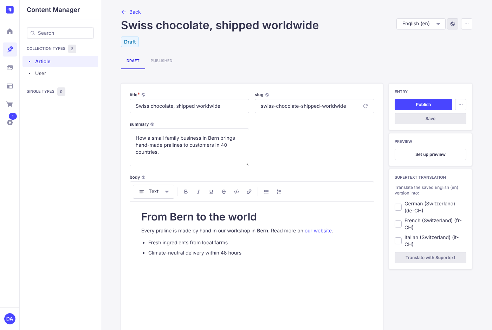
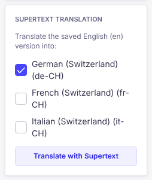
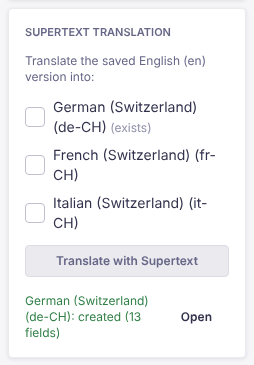
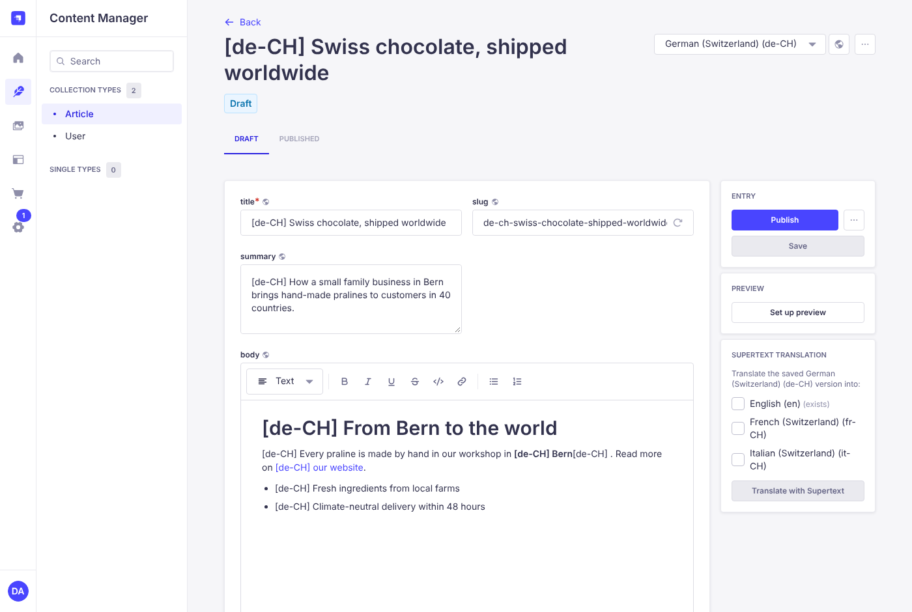
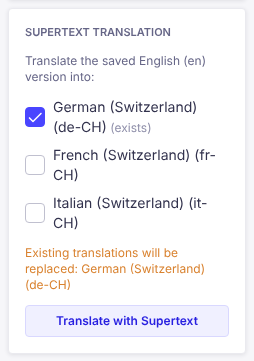

# User guide — Supertext Translation for Strapi

For editors. Once an administrator has installed the plugin (see [INSTALLATION.md](INSTALLATION.md)), you translate entries straight from the Content Manager.

*Screenshots are from the Strapi 5 demo in this repository.*

The Supertext panel, settings page and messages follow your Strapi interface language (English, German, French or Italian; change it under *Profile → Interface language*).

## Translate an entry

1. Open the entry in the **Content Manager** and make sure the language selector at the top right shows the language you want to translate **from** (usually your default language).
2. **Save** your changes. Supertext translates the saved version, not unsaved edits.
3. In the right-hand column, find the **Supertext translation** panel.
4. Tick the languages you want to translate **into**.
5. Click **Translate with Supertext**.

After a few seconds a green message confirms the result, and the panel lists each language, for example *French (Switzerland): created (13 fields)*. Click **Open** next to a language to jump to that translation.

## Review and publish

Translations are saved as **drafts**, so nothing goes live unreviewed.

1. Open the translation (**Open** in the panel, or the language selector at the top).
2. Read through it and adjust anything you'd phrase differently, then **Save**.
3. **Publish** when you're happy.

## Translating again

Languages that already have a translation are marked *(exists)*. If you tick one, the panel warns you that it will be **replaced**: all of its text is translated again from the current source. Use this after the source has changed a lot. To fix small things, edit the translation by hand instead, so your edits aren't lost.

When a translation is replaced, its URL slug is kept so existing links keep working. A new translation gets a slug built from its translated title.

## Export for translation and import a translated file

Instead of letting Supertext translate right away, you can export the entry as a file, have it translated elsewhere (by a translator, in a translation tool such as Trados, memoQ or Phrase, or in Supertext's web app) and import the translated file again. This doesn't use Supertext's API, so it also works without an API key.

### Export

1. Open the entry in the source language and **save** it: the file holds the saved version.
2. In the **Supertext translation** panel, tick the languages to translate **into** (the same checkboxes as for translating).
3. Under **Export for translation**, choose the **File format**:
   - **XLIFF 1.2 (for translation tools)**: the better choice for translators and translation tools. One file can hold several languages; formatting appears as protected tags the translator can move but not break.
   - **HTML (one language per file)**: for Supertext's web app or anyone who translates HTML. Tick exactly one language.
4. Click **Download file**. The file is called e.g. `strapi-article-<entry id>-fr-CH.xlf` (with several languages, without the language at the end).

The file holds exactly the texts *Translate with Supertext* would send (see *What gets translated*). If the entry has none, you get *Nothing to translate.* and no file.

Send the file to your translator, or upload it to Supertext's web app. In an **HTML file**, the translator must leave the head (the `supertext:` lines) and the `data-st-id` attributes alone and translate only the text between the tags. An HTML file can't mark a text as "not translated": imported unchanged, it writes the source text into the target language.

### Import

1. Open any entry and go to **Import translation** in the panel (the file itself says which entry and language it belongs to, so you can import it from anywhere).
2. Choose the **Translated file (XLIFF or HTML)** (at most 10 MB).
3. Leave **Also import texts whose source changed since the export** off, unless you want translations of texts that were edited after the export.
4. Click **Import translation**.

The translation is saved like a Supertext translation: as a **draft**, replacing the earlier translation of those fields (an existing translation keeps its URL slug, a new one gets one from its translated title). Then the panel shows a summary per language:

| Line | Meaning |
| --- | --- |
| *Imported: n* | Texts written into the language. **Open** jumps to it. |
| *Skipped, source changed since the export: n* | The source text was edited after the export, so the translation may be outdated. Import again with the option ticked to use it anyway. |
| *Not translated in the file: n* | The file has no translation for these texts. |
| *Formatting changed, not imported: n* | The translation broke or added formatting (tags) the source doesn't have. |
| *Not in the file: n* | Texts added to the entry after the export. |

Texts that weren't imported keep what the language already has there (or the source text where it has nothing yet, as with a Supertext translation).

Errors instead of a summary: *This file isn’t a valid XLIFF or HTML translation file.*, *This file wasn’t exported by the Supertext plugin, or its header was removed.*, *The file is too large (at most 10 MB).*, *This file belongs to another system (…)* (exported from another Supertext plugin), *The entry this file was exported from no longer exists.*, *The site has no language …* (the locale was removed) and *You may not edit these locales* (your role can't edit that language).

## What gets translated

- Text fields: short text, long text, rich text (Markdown) and rich text (Blocks). Bold, italic, underline, strikethrough, inline code, links, headings, lists and quotes are kept.
- The same field types inside **components** and **dynamic zones**, for example SEO texts or page sections.
- Every field that is translated per language. Fields shared across all languages (marked as not localized) are left alone.

## What is *not* translated

- Code blocks in rich text, numbers, dates, booleans, e-mail addresses and option lists. These are copied from the source as they are.
- Images and files are linked to the same media as the source.
- **Relations** (links to other entries) are not set on new translations; set them by hand. Existing translations keep theirs.
- Unsaved changes. Save first.

## Formal and informal language

Your administrator can set each language to formal (*Sie/vous*) or informal (*du/tu*). The current setting is visible under *Settings → Supertext → Translation → Languages*. Supertext doesn't offer this choice for every language (not for English, Swiss German, Romansh, Albanian or Serbian); those are translated in Supertext's default tone.

## When something goes wrong

The panel shows the reason next to the language that failed, in red, and the other languages are still translated. Common reasons:

| Message | What to do |
| --- | --- |
| *Supertext is not configured yet* | Ask an administrator to add the API key (the [installation guide](INSTALLATION.md#get-a-supertext-account-and-api-key) explains how to get one). |
| *You may not edit these locales* | Your role can't edit that language. Ask an administrator. |
| *The language … has no Supertext language yet* | The plugin has no default for this locale (for example *English (Ireland)*). Ask your administrator to choose its Supertext language under *Settings → Supertext → Translation*; the other languages are translated. |
| *Supertext does not support this language pair* | One of the languages isn't one Supertext translates. Ask an administrator to check the language under *Settings → Supertext → Translation*. |
| *Supertext offers no formal or informal tone for the language …* | The formal/informal setting for that language isn't available at Supertext (e.g. for English). Ask an administrator to set it to *Default* under *Settings → Supertext → Translation*. |
| *Your Supertext translation limit is exceeded* | The Supertext account's quota is used up. Contact your Supertext account manager. |
| *Timed out waiting* | Try again; for very long entries ask an administrator to raise the time limit. |

## Tips

- Translate into several languages at once; each language is one request to Supertext.
- Keep the source entry tidy (headings, lists) — the structure is carried over to every language.
